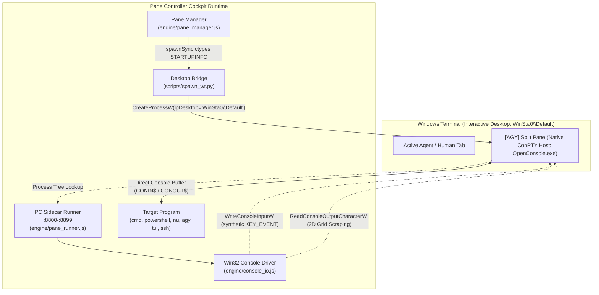
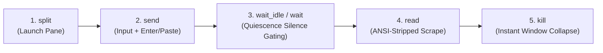

# Pane Controller — Autonomous Windows Terminal Cockpit & Subagent Duplex Control

[](https://microsoft.com/windows)
[](https://bun.sh)
[](https://python.org)
[](https://github.com/microsoft/terminal)
[](LICENSE)

**Pane Controller** provides deterministic, full-duplex interactive control over foreign CLI tools, interactive shells, and Text User Interfaces (TUIs) inside real [Windows Terminal](https://github.com/microsoft/terminal) panes. 

It was engineered specifically for autonomous AI agents (such as Antigravity, Albedo, and Overlord) to execute interactive and long-running programs (NuShell, PowerShell, SSH sessions, CLI REPLs, TUI dashboards, Docker logs, build monitors) **without blocking the agent's primary shell or execution environment**.

---

## Table of Contents

- [1. Overview & Core Philosophy](#1-overview--core-philosophy)
- [2. System Architecture & Direct Shared Console Design](#2-system-architecture--direct-shared-console-design)
  - [Zero Inner ConPTY Breakthrough](#zero-inner-conpty-breakthrough)
  - [Win32 Native Console Driver (`console_io.js`)](#win32-native-console-driver-console_iojs)
  - [Cross-Desktop Bridge (`spawn_wt.py`)](#cross-desktop-bridge-spawn_wtpy)
- [3. Complete Root Cause Error Forensics & Resolution Matrix](#3-complete-root-cause-error-forensics--resolution-matrix)
  - [Error 1: The "Exebox" Virtual Desktop Station Mismatch](#error-1-the-exebox-virtual-desktop-station-mismatch)
  - [Error 2: The Python `subprocess.STARTUPINFO` `lpDesktop` Mirage](#error-2-the-python-subprocessstartupinfo-lpdesktop-mirage)
  - [Error 3: Command Line Quoting & Bracket Mangling](#error-3-command-line-quoting--bracket-mangling)
  - [Error 4: Asynchronous `spawn` Early Exit in Bun](#error-4-asynchronous-spawn-early-exit-in-bun)
  - [Error 5: Lingering `OpenConsole.exe` Split Window After Kill](#error-5-lingering-openconsoleexe-split-window-after-kill)
  - [Error 6: Nested ConPTY Collision & Mouse Scroll Coordinate Garbage](#error-6-nested-conpty-collision--mouse-scroll-coordinate-garbage)
- [4. Operational Protocol: Spawn ➔ Probe ➔ Gate ➔ Read](#4-operational-protocol-spawn--probe--gate--read)
- [5. CLI Command Reference (`pane_ctl.py`)](#5-cli-command-reference-pane_ctlpy)
- [6. Fleet Forensics Tool (`pane_probe.py`)](#6-fleet-forensics-tool-pane_probepy)
- [7. Model Context Protocol (MCP) Server Integration](#7-model-context-protocol-mcp-server-integration)
- [8. Production Workflows & Recipes](#8-production-workflows--recipes)
  - [NuShell (`nu`)](#nushell-nu)
  - [Interactive PowerShell & CMD](#interactive-powershell--cmd)
  - [Cloudflare Wrangler CLI](#cloudflare-wrangler-cli)
  - [Interactive Overlord / OpenCode TUI Chat](#interactive-overlord--opencode-tui-chat)
- [9. Safety, Network Hygiene & Anti-Patterns](#9-safety-network-hygiene--anti-patterns)
- [10. Project Structure & Directory Layout](#10-project-structure--directory-layout)

---

## 1. Overview & Core Philosophy

When autonomous AI agents execute terminal commands using traditional subshells (`subprocess.run`, `child_process.exec`, or direct tool execution), they encounter several critical roadblocks:

1. **Blocking Stalls**: Interactive programs expecting user input (e.g. `gcloud init`, `ssh`, `wrangler login`, `npm init`) freeze the agent indefinitely waiting on `stdin`.
2. **Loss of Context & Visibility**: Background daemons run detached in hidden subshells where output cannot be reviewed live by human operators.
3. **Inner ConPTY Corruptions**: Standard programmatic terminal emulators on Windows spawn inner pseudo-terminals that fight with the real console window, resulting in cursor tearing, dropped characters, and VT sequence glitches.
4. **Desktop Station Isolation**: Background agent services run in non-interactive window stations (e.g. `exebox-<GUID>`), preventing standard `wt.exe` calls from attaching to the user's desktop screen.

**Pane Controller solves all of these problems permanently.** It splits Windows Terminal directly onto the user's interactive desktop (`WinSta0\Default`), runs the target command in a direct shared console slot, captures telemetry via a local HTTP IPC sidecar (ports `8800–8899`), injects Win32 hardware-level keystrokes, and provides clean ANSI-stripped output scraping with silence gating.

---

## 2. System Architecture & Direct Shared Console Design



### Zero Inner ConPTY Breakthrough
Traditional terminal automation frameworks attempt to spawn a virtual pseudo-terminal (such as `node-pty` or `Bun.spawn({ terminal })`) inside Windows Terminal. On Windows, this creates a catastrophic **Nested ConPTY Collision**:
* Windows Terminal already wraps the pane inside its own native ConPTY host (`OpenConsole.exe`).
* Nesting an inner ConPTY creates two competing VT parser state machines and cursor positions.
* When panes are resized or run at narrow widths (e.g., 68 columns), cursor wrapping desynchronizes, causing ghost text prefixes and duplicate line artifacts.

**The Solution:** Pane Controller uses **Zero Inner ConPTY**. The child process and `pane_runner.js` share the Windows Terminal console buffer directly via `stdio: ["inherit", "inherit", "inherit"]`. Zero double-rendering, zero coordinate desynchronization.

### Win32 Native Console Driver (`console_io.js`)
Instead of piping text through simulated stdin pipes that mangle ANSI control sequences, `console_io.js` interacts directly with Windows `kernel32.dll` via `bun:ffi`:
- **Input Injection**: Opens `CONIN$` via `CreateFileW` and injects synthetic `KEY_EVENT` records directly into the console input buffer using `WriteConsoleInputW`. Both `bKeyDown = 1` and `bKeyDown = 0` events are generated with proper scan codes, virtual keys, and modifier states.
- **2D Screen Buffer Extraction**: Opens `CONOUT$` and reads characters directly off the active screen grid using `ReadConsoleOutputCharacterW`. This reads the physical screen state with zero ANSI noise.
- **Settle Time Deduplication**: A 300ms quiescence settle-time ensures scraping occurs only after terminal reflow and redraw complete.

### Cross-Desktop Bridge (`spawn_wt.py`)
Because agent background services execute within isolated window stations, `spawn_wt.py` leverages native Win32 `CreateProcessW` with `STARTUPINFO.lpDesktop = "WinSta0\\Default"` to seamlessly route split-pane commands to the active desktop session where the user and Windows Terminal reside.

---

## 3. Complete Root Cause Error Forensics & Resolution Matrix

Every edge case, architectural hurdle, and failure mode discovered during battle-testing is documented below along with its root-cause forensic diagnosis and permanent solution:

### Error 1: The "Exebox" Virtual Desktop Station Mismatch
* **Symptom**: Calling `wt.exe split-pane` from an AI background tool returned exit code `0`, but no split pane appeared on the screen. The registry remained stuck in `spawning` indefinitely, and orphaned `WindowsTerminal.exe` background processes accumulated.
* **Forensic Diagnosis**: Deep introspection of Win32 desktop stations via `GetProcessWindowStation()` and `GetThreadDesktop()` revealed that background agent tools run inside a headless, isolated virtual desktop station (`exebox-<GUID>`). The user's active Windows Terminal instance runs on `WinSta0\Default`. Because `wt.exe` is a Centennial App Execution Alias, it queried for terminal instances on `exebox-<GUID>`, found none, and launched a headless terminal instance that immediately closed.
* **The Sovereign Fix**: Engineered `scripts/spawn_wt.py`. It invokes Win32 `CreateProcessW` explicitly targeting `lpDesktop = "WinSta0\\Default"`. This forces the split command into the interactive user desktop, cleanly docking beside the active window.

### Error 2: The Python `subprocess.STARTUPINFO` `lpDesktop` Mirage
* **Symptom**: Attempting `si = subprocess.STARTUPINFO(); si.lpDesktop = r"WinSta0\Default"` in Python did not switch desktops; child processes still booted inside `exebox`.
* **Forensic Diagnosis**: Inspected `dir(subprocess.STARTUPINFO)` and CPython source code. The Python standard library `subprocess` module does **not** expose the underlying C-level `lpDesktop` field of Win32 `STARTUPINFO`. Assigning `si.lpDesktop` merely created an unused dynamic attribute in Python's dictionary that Windows `CreateProcess` completely ignored.
* **The Sovereign Fix**: Implemented a full Win32 `STARTUPINFO` ctypes structure in `spawn_wt.py` with real memory offsets, passing the wchar pointer directly to `kernel32.CreateProcessW`.

### Error 3: Command Line Quoting & Bracket Mangling
* **Symptom**: Passing titles with brackets (such as `[AGY] Antigravity CLI`) or file paths with spaces through `cmd.exe /c wt.exe` broke argument parsers, truncating arguments or causing the pane to immediately crash on boot.
* **Forensic Diagnosis**: Chained command lines passing through `cmd.exe` and `wt.exe split-pane` undergo multiple inconsistent unescaping and re-quoting passes.
* **The Sovereign Fix**: Created the **Zero-Mangling Config Injection Pattern**:
  1. `pane_manager.js` writes all launch parameters (`title`, `command`, `session_id`, `workdir`, `cols`, `rows`, hygiene flags) into `data/panes/<pane_id>/config.json`.
  2. `spawn_wt.py` is called with only `--id <pane_id>` on the command line.
  3. `pane_runner.js` loads `config.json` directly from disk on boot, guaranteeing 100% parameter fidelity with zero shell escaping bugs.

### Error 4: Asynchronous `spawn` Early Exit in Bun
* **Symptom**: Running `pane_ctl.py split` occasionally exited without launching the pane, requiring a second manual attempt.
* **Forensic Diagnosis**: `pane_ctl.py` terminates its process via `process.exit(0)` when the tool execution promise resolves. `pane_manager.js` originally used asynchronous `child_process.spawn()` to call `spawn_wt.py`. On fast multi-core systems, Bun exited before the operating system finished spawning the Python subprocess.
* **The Sovereign Fix**: Switched to synchronous execution (`child_process.spawnSync`). Because `spawn_wt.py` executes in under 25ms, `spawnSync` guarantees process creation before returning control to the caller.

### Error 5: Lingering `OpenConsole.exe` Split Window After Kill
* **Symptom**: Running `pane_ctl.py kill <pane_id>` terminated the child shell (`cmd.exe` or `bun.exe`), but the split pane remained visible on screen displaying `[Process exited with code 0]`.
* **Forensic Diagnosis**: Windows Terminal's native ConPTY host (`OpenConsole.exe`) remains bound to the pane viewport unless its profile explicitly specifies `closeOnExit: "always"`.
* **The Sovereign Fix**: Enhanced `killPane()` in `pane_manager.js` to inspect the process tree, locate the parent `OpenConsole.exe` owning `pane.pid`, and terminate it. The split pane collapses and vanishes from the screen immediately.

### Error 6: Nested ConPTY Collision & Mouse Scroll Coordinate Garbage
* **Symptom**: Columns 1–9 retained frozen prefixes from earlier turns, and moving the mouse over the split pane spewed garbage sequences like `21M5;20;21M` into the active prompt.
* **Forensic Diagnosis**: The legacy runner spawned an inner pseudo-terminal via `Bun.spawn({ terminal })` inside Windows Terminal's outer ConPTY. At narrow column widths (~68 cols), VT cursor reflow desynchronized. Additionally, slicing raw stdin streams split SGR mouse escape sequences across buffers.
* **The Sovereign Fix**: Completely eliminated the inner ConPTY. `pane_runner.js` attaches directly to the native console buffer via `console_io.js`, supplemented by an atomic SGR mouse escape filter that strips raw tracking packets.

---

## 4. Operational Protocol: Spawn ➔ Probe ➔ Gate ➔ Read

Autonomous agents should follow the **Spawn ➔ Probe ➔ Gate ➔ Read** protocol to ensure 100% deterministic interaction with interactive programs:



1. **Launch Split Pane**:
   ```bash
   python scripts/pane_ctl.py split "powershell.exe -NoLogo" --title "Build Auditor" --split vertical --size 0.45
   ```
2. **Send Command / Input**:
   ```bash
   python scripts/pane_ctl.py send pane-xxxxxxxx-yyyyy "Get-Service | Where-Object Status -eq 'Running'" --submit
   ```
3. **Gate on Quiescence (Wait for silence)**:
   Never attempt to read immediately after typing. Wait for the terminal output to settle:
   ```bash
   python scripts/pane_ctl.py wait_idle pane-xxxxxxxx-yyyyy --idle 1500 --timeout 30000
   ```
   *Alternatively, gate on a regex pattern:*
   ```bash
   python scripts/pane_ctl.py wait pane-xxxxxxxx-yyyyy "PS C:\\.*>" --timeout 15000
   ```
4. **Scrape Clean Output**:
   ```bash
   python scripts/pane_ctl.py read pane-xxxxxxxx-yyyyy --lines 35
   ```
5. **Teardown**:
   ```bash
   python scripts/pane_ctl.py kill pane-xxxxxxxx-yyyyy
   ```

---

## 5. CLI Command Reference (`pane_ctl.py`)

The unified CLI bridge `scripts/pane_ctl.py` provides full programmatic access for scripts, agents, and subagents:

| Command | Syntax | Description |
|---|---|---|
| **`list`** | `python pane_ctl.py list` | List all active panes with PID, port, status, and command |
| **`split`** | `python pane_ctl.py split "<cmd>" [--title "<title>"] [--split vertical\|horizontal] [--size 0.45]` | Launch a new split pane beside or below active session |
| **`send`** | `python pane_ctl.py send <pane_id> "<text>" [--submit] [--paste]` | Inject text into stdin (`--submit` adds Enter, `--paste` uses bracketed paste) |
| **`key`** | `python pane_ctl.py key <pane_id> <key_name>` | Inject virtual key event (`Enter`, `Ctrl+C`, `Esc`, `Tab`, `Up`, `Down`) |
| **`read`** | `python pane_ctl.py read <pane_id> [--lines 30] [--raw]` | Scrape buffer lines (`--raw` preserves ANSI escapes; default strips ANSI) |
| **`wait`** | `python pane_ctl.py wait <pane_id> "<regex>" [--timeout 15000]` | Block until regex pattern appears in output stream |
| **`wait_idle`** | `python pane_ctl.py wait_idle <pane_id> [--idle 1500] [--timeout 30000]` | Block until terminal is silent for N milliseconds |
| **`kill`** | `python pane_ctl.py kill <pane_id>` | Terminate pane and collapse Windows Terminal split immediately |
| **`clear`** | `python pane_ctl.py clear` | Clean completed and dead pane records from the registry |
| **`json`** | `python pane_ctl.py json '{"action": "list"}'` | Raw JSON execution of any engine action |

---

## 6. Fleet Forensics Tool (`pane_probe.py`)

`scripts/pane_probe.py` provides flight log auditing, cross-pane log searching, and proxy hygiene checks across the entire pane fleet:

```bash
# List all historical panes with age, log size, and transcript metadata
python scripts/pane_probe.py list

# View the full flight log of a pane
python scripts/pane_probe.py log <pane_id>

# View an ANSI-stripped raw log
python scripts/pane_probe.py raw <pane_id>

# Grep across every historical flight log
python scripts/pane_probe.py find "error|failed|exception"

# Show panes modified in the last 2 hours
python scripts/pane_probe.py active

# Verify that proxy environment variables are clean
python scripts/pane_probe.py hygiene
```

---

## 7. Model Context Protocol (MCP) Server Integration

Pane Controller exposes a high-performance Model Context Protocol (MCP) server implemented in `engine/pane_mcp_server.js`.

### Client Configuration (`mcp.json`)

To register the MCP server with Antigravity, Claude Desktop, Cursor, or Windsurf, add it to your `mcp.json`:

```json
{
  "mcpServers": {
    "pane-controller": {
      "command": "bun",
      "args": [
        "C:\\Users\\ahmed\\.gemini\\skills\\pane-controller\\engine\\pane_mcp_server.js"
      ]
    }
  }
}
```

### Exposed MCP Tools (16)

| Tool Name | Parameters | Purpose |
|---|---|---|
| `pane_split` | `command`, `title`, `split`, `size`, `workdir`, `auto_close`, `keep_on_error`, `sanitize_proxy` | Launch a split pane in Windows Terminal |
| `pane_send_input` | `pane_id`, `text`, `submit`, `paste` | Send text via Win32 `WriteConsoleInputW` |
| `pane_send_key` | `pane_id`, `key` | Inject virtual key event (`Enter`, `Ctrl+C`, `Esc`, `Tab`, etc.) |
| `pane_read_output`| `pane_id`, `lines`, `clean` | Scrape settled buffer with ANSI stripping |
| `pane_read_screen`| `pane_id` | Extract exact 2D character grid directly from `CONOUT$` |
| `pane_wait_for` | `pane_id`, `pattern`, `timeout_ms` | Block on regex pattern match |
| `pane_wait_idle` | `pane_id`, `idle_ms`, `timeout_ms` | Block until terminal silence quiescence |
| `pane_status` | `pane_id` | Rich process telemetry (PID, child name, memory, uptime) |
| `pane_list` | `session_id` | Enumerate active and historical panes |
| `pane_kill` | `pane_id` | Terminate process and collapse split pane |
| `pane_restart` | `pane_id`, `command` | Restart child command in-place inside the same slot |
| `pane_focus` | `direction` | Shift pane focus (`next`, `previous`, `left`, `right`, `up`, `down`) |
| `pane_resize` | `direction`, `amount` | Adjust split pane aspect ratio |
| `pane_zoom` | *(none)* | Toggle maximize / restore for active pane |
| `pane_repaint` | `pane_id` | Force complete screen redraw |
| `pane_clear` | *(none)* | Purge dead records from registry |

---

## 8. Production Workflows & Recipes

### NuShell (`nu`)
NuShell uses a structured AST parser. Always send one statement per `send_input`:
```bash
# 1. Launch NuShell side-by-side
python scripts/pane_ctl.py split "nu" --title "NuShell" --split vertical --size 0.42

# 2. Check environment proxy hygiene
python scripts/pane_ctl.py send <pane_id> "echo $'proxy=[$env.HTTP_PROXY?][$env.HTTPS_PROXY?][$env.ALL_PROXY?]'" --submit
python scripts/pane_ctl.py wait_idle <pane_id> --idle 1000
python scripts/pane_ctl.py read <pane_id> --lines 10
# Output confirms: proxy=[][][]
```

### Interactive PowerShell & CMD
```bash
# 1. Launch PowerShell
python scripts/pane_ctl.py split "powershell.exe -NoLogo" --title "PowerShell" --split vertical

# 2. Run command and inspect top memory processes
python scripts/pane_ctl.py send <pane_id> "Get-Process | Sort-Object WS -Descending | Select -First 5" --submit
python scripts/pane_ctl.py wait_idle <pane_id> --idle 2000
python scripts/pane_ctl.py read <pane_id> --lines 20
```

### Cloudflare Wrangler CLI
```bash
# 1. Run version check and gate on output
python scripts/pane_ctl.py send <pane_id> "wrangler --version" --submit
python scripts/pane_ctl.py wait <pane_id> "wrangler|v3\." --timeout 20000

# 2. Query authenticated account
python scripts/pane_ctl.py send <pane_id> "wrangler whoami" --submit
python scripts/pane_ctl.py wait_idle <pane_id> --idle 3000
python scripts/pane_ctl.py read <pane_id> --lines 25
```

### Interactive Overlord / OpenCode TUI Chat
When sending normal conversational prompts into an interactive OpenCode or Overlord TUI session:
1. **Always deliver with `--paste`**: Bracketed paste (`\x1b[200~...` and `\x1b[201~`) signals the TUI virtual DOM that the text is an atomic chat turn rather than sequential keyboard commands:
   ```bash
   python scripts/pane_ctl.py send <pane_id> "Explain the ConPTY architecture" --paste --submit
   ```
2. **Never start messages with punctuation like `!`**: Leading punctuation characters trigger command execution modes in NuShell and OpenCode.

---

## 9. Safety, Network Hygiene & Anti-Patterns

### Hygiene Flags (Default Enabled)
- **`sanitize_proxy: true`**: Automatically strips `HTTP_PROXY`, `HTTPS_PROXY`, and `ALL_PROXY` from the child environment upon launch. Prevents accidental network-wide deadlocks from local proxies (e.g. Tor/OnionFruit).
- **`keep_on_error: true`**: If a child process crashes or exits with a non-zero exit code, the pane stays open so the agent or human operator can inspect error stack traces.
- **`auto_close: false`**: Keeps the pane open after completion until explicitly dismissed, allowing full post-execution scraping.

### Anti-Patterns to Avoid
- ❌ **Calling `wt.exe` directly from agent background tools**: This triggers the Exebox station mismatch bug. Always use `spawn_wt.py` or `pane_ctl.py`.
- ❌ **Reading immediately after sending input**: Always gate on quiescence (`wait_idle`) or regex pattern (`wait_for`) before scraping with `read`.
- ❌ **Sending bare unvetted keystrokes in TUIs**: In interactive curses/TUI apps, bare single characters (`?`, `d`, `u`) may invoke destructive actions (delete, unstage, upgrade). Always check footer status legends first.

---

## 10. Project Structure & Directory Layout

```
pane-controller/
├── .gitignore                      # Ignores runtime states, data/panes, and logs
├── README.md                       # Comprehensive documentation & architecture guide
├── SKILL.md                        # Antigravity skill specification & operational directives
├── data/
│   ├── .gitkeep                    # Retains data directory structure in git
│   ├── pane_registry.example.json  # Reference schema for pane registry
│   └── panes/                      # [Ignored] Runtime pane working directories & flight logs
├── engine/
│   ├── console_io.js               # Win32 Native Console Driver (bun:ffi kernel32 binding)
│   ├── pane_controller.ts          # Core execution engine & schema definition
│   ├── pane_manager.js             # Process manager, port allocator, and WT launcher
│   ├── pane_mcp_server.js          # Model Context Protocol (MCP) Server (16 tools)
│   ├── pane_registry.json          # Active pane registry
│   └── pane_runner.js              # Per-pane HTTP IPC sidecar (:8800-:8899)
├── references/
│   ├── recipes.md                  # Battle-tested command workflows & recipes
│   └── tool-schema.md              # 22-parameter reference dictionary
└── scripts/
    ├── pane_ctl.py                 # Unified CLI bridge for shell scripts & agents
    ├── pane_probe.py               # Fleet forensics, flight log viewer & proxy hygiene
    └── spawn_wt.py                 # Win32 CreateProcessW cross-desktop launcher
```

---

## License

This project is released under the [MIT License](LICENSE).
