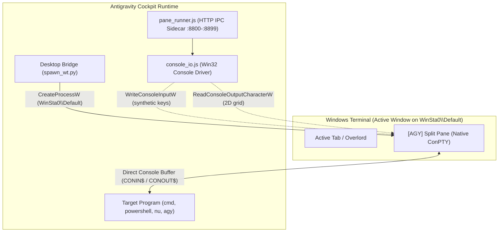

# Pane Controller — Antigravity Sovereign Terminal Cockpit

## 1. Core Architecture & Isolation Directives

`pane-controller` provides full-duplex interactive control over foreign CLI tools, interactive shells, and TUI programs inside Windows Terminal panes without blocking or hijacking Antigravity's execution environment.

### Sovereign Isolation Contract
* **Sandbox Root**: `C:\Users\ahmed\.gemini\skills\pane-controller\`
* **Data & Runtime State**: `C:\Users\ahmed\.gemini\skills\pane-controller\data\`
  * Registry: `data/pane_registry.json`
  * Panes directory: `data/panes/<pane_id>/`
  * Flight logs: `data/panes/<pane_id>/flight.log`
  * Pane configs: `data/panes/<pane_id>/config.json`
* **Assigned IPC Port Range**: Strictly **`8800–8899`** *(Overlord Conclave is assigned `7000–7099`)*.
* **Visual Title Prefix**: Every pane title is automatically prepended with `[AGY] ` so Dr. Ahmed can distinguish it visually.
* **Overlord Sentinel Boundary**: NEVER read, write, modify, or tamper with any file in `~/.config/opencode/`, `overlord-v2/`, or `albedo-core-v2/`.

---

## 2. Complete Error Forensics & Resolution Matrix

Every edge case, failure mode, and structural anomaly discovered across development sessions is documented here with root cause forensics and permanent solutions:

### Error 1: The "Exebox" Virtual Desktop Station Mismatch
* **Symptom**: Calling `wt.exe split-pane` returned exit code `0`, but no pane appeared in Windows Terminal, and registry status stayed stuck in `spawning` indefinitely. Orphan/zombie `WindowsTerminal.exe` background processes accumulated.
* **Forensic Diagnosis**: Deep introspection of Win32 desktop stations via `GetProcessWindowStation()` and `GetThreadDesktop()` revealed that Antigravity background tools execute inside a headless, isolated virtual desktop station (`exebox-<GUID>`). Dr. Ahmed and Overlord operate on the interactive `WinSta0\Default` desktop. Because `wt.exe` is a Centennial App Execution Alias, it queried Windows Terminal on `exebox-<GUID>`. Finding none, it attempted to launch a headless GUI instance that immediately terminated.
* **The Sovereign Fix**: Built `scripts/spawn_wt.py`, which invokes native Win32 `CreateProcessW` with `STARTUPINFO.lpDesktop = "WinSta0\\Default"`. This routes the split command directly to the active terminal on Dr. Ahmed's interactive screen.

### Error 2: The Python `subprocess.STARTUPINFO` `lpDesktop` Attribute Mirage
* **Symptom**: Writing `si = subprocess.STARTUPINFO(); si.lpDesktop = r"WinSta0\Default"` in Python did not switch desktops; child processes still booted inside `exebox`.
* **Forensic Diagnosis**: Inspected `dir(subprocess.STARTUPINFO)` and discovered that Python's standard library `subprocess` module does **not** expose the `lpDesktop` field in its C-level structure. Setting `si.lpDesktop` merely created an unused dynamic Python attribute that Windows `CreateProcess` ignored.
* **The Sovereign Fix**: Implemented a complete Win32 `STARTUPINFO` ctypes structure in `spawn_wt.py` to directly populate the real `lpDesktop` pointer in the kernel32 `CreateProcessW` call.

### Error 3: Command Line Quoting & Bracket Mangling
* **Symptom**: Passing pane titles with brackets (like `[AGY] Antigravity CLI`) or paths with spaces via `cmd.exe /c wt.exe` caused Windows argument parsers to break, dropping tokens or closing the pane on startup.
* **Forensic Diagnosis**: Windows Terminal CLI (`wt.exe`) and `cmd.exe` perform multiple inconsistent unescaping passes when command lines are chained.
* **The Sovereign Fix**: Engineered the **Zero-Mangling Config Injection Pattern**:
  1. `pane_manager.js` serializes all launch parameters (`title`, `command`, `session_id`, `dir`, `cols`, `rows`, hygiene flags) into `data/panes/<pane_id>/config.json`.
  2. `spawn_wt.py` is invoked with only `--id <pane_id>` on the command line.
  3. `pane_runner.js` reads `config.json` directly from disk on boot, ensuring 100% argument fidelity with zero shell escaping bugs.

### Error 4: Asynchronous `spawn` Early Exit in Bun
* **Symptom**: Running `pane_ctl.py split` sometimes exited without launching the pane, requiring a second manual call.
* **Forensic Diagnosis**: `pane_ctl.py` terminates its process via `process.exit(0)` once the tool execution promise completes. `pane_manager.js` was using asynchronous `child_process.spawn()` to call `spawn_wt.py`. On fast machines, Bun exited before the OS finished creating the Python process.
* **The Sovereign Fix**: Replaced asynchronous `spawn` with `child_process.spawnSync` in `pane_manager.js`. Since `spawn_wt.py` executes in ~25ms, `spawnSync` guarantees process creation before returning.

### Error 5: Lingering `OpenConsole.exe` Split Window After Kill
* **Symptom**: Running `pane_ctl.py kill <pane_id>` terminated `bun.exe` and `cmd.exe`, but the split pane stayed visible on Dr. Ahmed's screen displaying `[Process exited with code 0]`.
* **Forensic Diagnosis**: Windows Terminal's native ConPTY host (`OpenConsole.exe`) remains attached to the pane viewport unless its profile explicitly specifies `closeOnExit: "always"`.
* **The Sovereign Fix**: Upgraded `killPane()` in `pane_manager.js` to look up the parent `OpenConsole.exe` process owning `pane.pid` and terminate it, causing the split pane to collapse and vanish from Dr. Ahmed's window instantly.

### Error 6: Nested ConPTY Collision & Mouse Scroll Coordinate Garbage
* **Symptom**: Text columns 1–9 retained frozen prefixes from earlier turns, and moving the mouse over the split pane spewed garbage strings like `21M5;20;21M` into the prompt.
* **Forensic Diagnosis**: The old runner spawned an inner pseudo-terminal via `Bun.spawn({ terminal })` inside Windows Terminal's outer ConPTY. At narrow column widths (~68 cols), cursor VT reflow desynchronized. Slicing raw stdin streams broke mouse SGR escape sequences across chunks.
* **The Sovereign Fix**: Eliminated the inner ConPTY completely (`stdio: ["inherit", "inherit", "inherit"]`). `pane_runner.js` and child shells attach directly to Windows Terminal's native console. Input and output are managed via the Win32 driver (`console_io.js`) with atomic SGR mouse stream filtering.

---

## 3. Direct Shared Console Architecture (Zero Inner ConPTY)



* **Elimination of Nested ConPTYs**: The child process runs attached directly to Windows Terminal's console buffer. Zero double-rendering, zero reflow conflicts.
* **Win32 Input Driver**: `console_io.js` injects synthetic keyboard events directly into `CONIN$` via Win32 `WriteConsoleInputW`.
* **2D Screen Poller**: Screen scraping reads the live 2D character grid directly via `ReadConsoleOutputCharacterW` with 300ms settle-time deduplication.

---

## 4. Operational Guide (Step-by-Step)

### A. How to Start a Pane Smoothly
Always invoke the unified CLI bridge `pane_ctl.py`:

```powershell
# Split an Antigravity CLI pane beside the active session
python C:\Users\ahmed\.gemini\skills\pane-controller\scripts\pane_ctl.py split "agy" --title "Antigravity CLI" --split vertical --size 0.45

# Split an interactive PowerShell pane
python C:\Users\ahmed\.gemini\skills\pane-controller\scripts\pane_ctl.py split "powershell.exe -NoLogo" --title "PowerShell" --split vertical

# Split a stacked horizontal NuShell pane
python C:\Users\ahmed\.gemini\skills\pane-controller\scripts\pane_ctl.py split "nu" --title "NuShell" --split horizontal --size 0.35
```

### B. How to Converse with the Pane (Spawn ➔ Probe ➔ Gate ➔ Read)
Never attempt to read immediately after typing. Follow this protocol:


1. **Send Text / Command**:
   ```powershell
   python C:\Users\ahmed\.gemini\skills\pane-controller\scripts\pane_ctl.py send <pane_id> "Hello Albedo" --submit
   ```
2. **Gate on Quiescence (Wait for silence)**:
   ```powershell
   python C:\Users\ahmed\.gemini\skills\pane-controller\scripts\pane_ctl.py wait_idle <pane_id> --idle 1500 --timeout 30000
   ```
   *(Or gate on a regex prompt pattern like `">|Ready"` using `wait <pane_id> "<pattern>"`).*
3. **Read Clean Output**:
   ```powershell
   python C:\Users\ahmed\.gemini\skills\pane-controller\scripts\pane_ctl.py read <pane_id> --lines 25
   ```

### C. How to Kill the Pane Smoothly
```powershell
# Terminate pane and instantly collapse the split window
python C:\Users\ahmed\.gemini\skills\pane-controller\scripts\pane_ctl.py kill <pane_id>

# Clean registry of dead/completed pane records
python C:\Users\ahmed\.gemini\skills\pane-controller\scripts\pane_ctl.py clear
```

---

## 5. Complete CLI Command Reference (`pane_ctl.py`)

| Command | Syntax | Description |
|---|---|---|
| **List** | `python pane_ctl.py list` | List all active panes with PID, port, and status |
| **Split** | `python pane_ctl.py split "<cmd>" [--title "<title>"] [--split vertical\|horizontal] [--size 0.45]` | Launch a new split pane beside current session |
| **Send Text** | `python pane_ctl.py send <pane_id> "<text>" [--submit] [--paste]` | Inject text into pane stdin (`--submit` sends Enter) |
| **Send Key** | `python pane_ctl.py key <pane_id> <key_name>` | Inject virtual key (`Enter`, `Ctrl+C`, `Esc`, `Tab`, `Up`, `Down`) |
| **Read Output** | `python pane_ctl.py read <pane_id> [--lines 30] [--raw]` | Scrape buffer lines (`--raw` preserves ANSI escapes) |
| **Wait Pattern** | `python pane_ctl.py wait <pane_id> "<pattern>" [--timeout 15000]` | Block until regex pattern appears in output stream |
| **Wait Idle** | `python pane_ctl.py wait_idle <pane_id> [--idle 1500] [--timeout 30000]` | Block until output is silent for N ms |
| **Kill** | `python pane_ctl.py kill <pane_id>` | Terminate pane and collapse Windows Terminal split |
| **Clear** | `python pane_ctl.py clear` | Purge finished/dead pane records from registry |

---

## 6. MCP Server Integration

Registered in `C:\Users\ahmed\.agents\mcp.json` as `pane-controller`:

```json
{
  "command": "C:\\Users\\ahmed\\.bun\\bin\\bun.exe",
  "args": ["C:\\Users\\ahmed\\.gemini\\skills\\pane-controller\\engine\\pane_mcp_server.js"]
}
```

Exposed MCP Tools:
* `pane_split`: Spawns a new split pane
* `pane_send_input`: Injects text with optional submit/paste
* `pane_send_key`: Virtual key event injection
* `pane_read_output`: Buffer scraper with clean ANSI stripping
* `pane_read_screen`: Direct 2D console buffer read
* `pane_wait_for`: Regex pattern gating
* `pane_wait_idle`: Silence / quiescence gating
* `pane_suspend` / `pane_resume`: Suspend/resume child processes
* `pane_status`: Metrics and PID tracking
* `pane_list`: Registry listing
* `pane_kill`: Pane termination and split collapse
* `pane_clear`: Dead record cleanup

---

## 7. Safety, Hygiene & Anti-Patterns

1. **Hygiene Flags**:
   * `sanitize_proxy: true` (default): Strips `HTTP_PROXY`, `HTTPS_PROXY`, `ALL_PROXY` from the child environment to prevent network leaks.
   * `keep_on_error: true` (default): Keeps the pane visible on non-zero exit so failures can be inspected.
   * `auto_close: false` (default): Prevents the pane from closing until explicitly dismissed with `kill`.
2. **Escaping Wedged Prompts**:
   * If a foreign CLI hangs in a continuation prompt, send `Ctrl+C` via `pane_ctl.py key <pane_id> Ctrl+C` before sending new text.
3. **TUI Bare Keystroke Hazard**:
   * In interactive TUIs, never send unvetted bare characters (`?`, `u`, `d`, etc.) as they may trigger destructive actions (uninstall, upgrade, delete). Always inspect the footer key legend with `read_output` first.
4. **Overlord / OpenCode TUI Normal Chat Messaging Rule**:
   * When sending normal conversation/chat prompts to an interactive Overlord or OpenCode session:
     * Always deliver with `--paste` (e.g. `pane_ctl.py send <pane_id> "my message" --paste --submit`). Bracketed paste informs the TUI virtual DOM that the text is an atomic chat prompt rather than terminal command input.
     * Never start messages with punctuation like `!` which triggers NuShell/Bash command execution mode in OpenCode.
5. **Anti-Patterns**:
   * ❌ Calling `wt.exe` directly from background agent tools without `spawn_wt.py` (causes Exebox station mismatch).
   * ❌ Calling `read_output` immediately after `send_input` without `wait_idle` or `wait_for`.
   * ❌ Touching any file in Overlord's Conclave directory (`~/.config/opencode/`).
